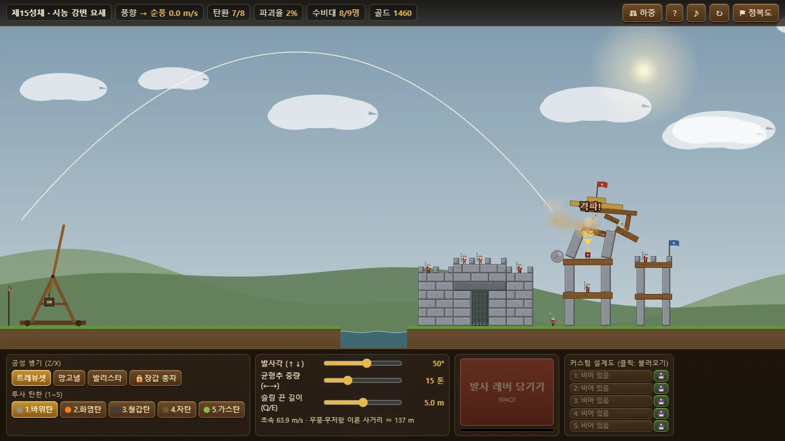
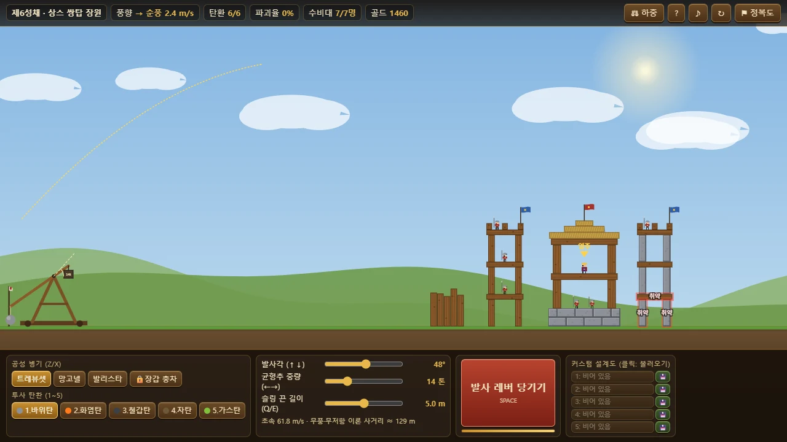
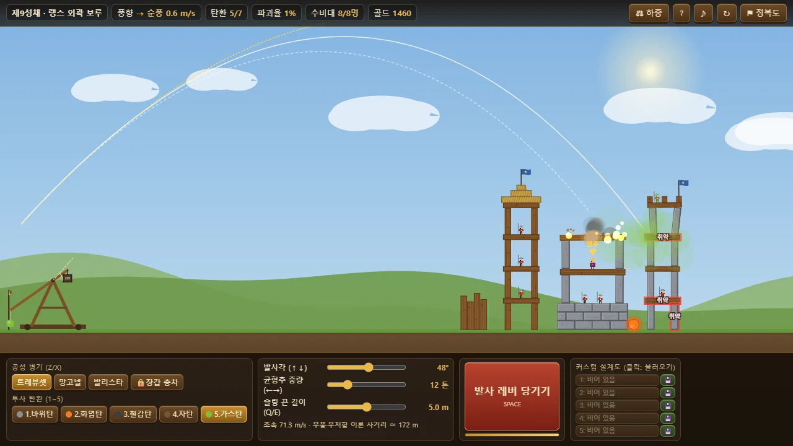
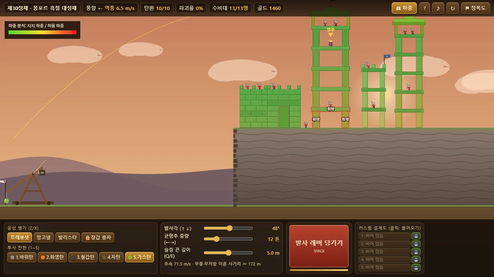
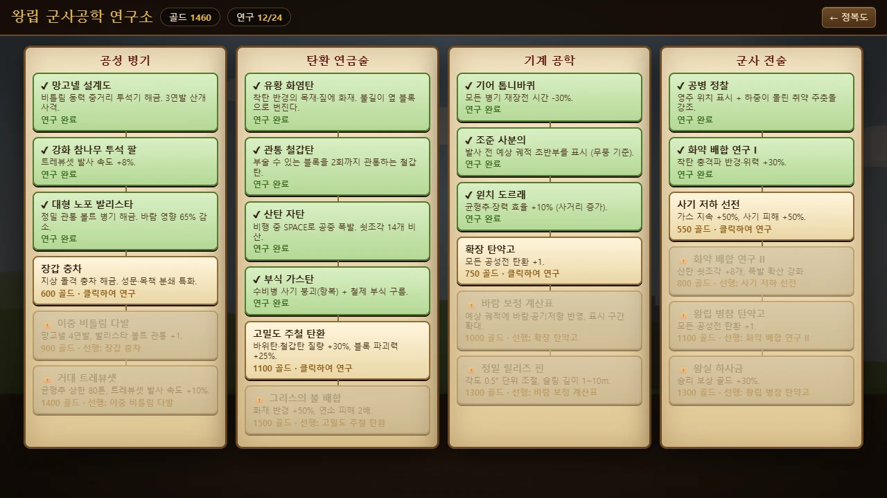
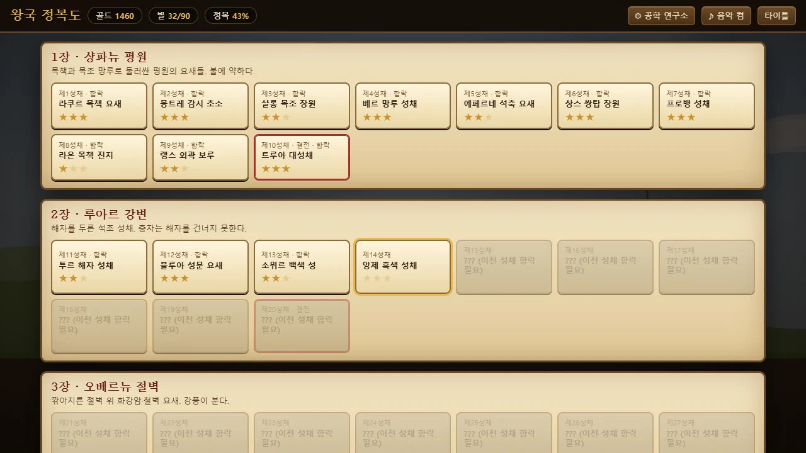

<div align="center">

# 🏰 Royal Siege Engineer : 왕립 공성 공학자

**로버트 드 발루아와 서른 성채의 반란 — 트레뷰셋 탄도학 & 성벽 붕괴 강체 물리 퍼즐 타이쿤**  
외부 라이브러리·이미지·사운드 파일 없이 **자체 제작 2D 강체 물리 엔진 · HTML5 Canvas · Web Audio API**만으로 만든 **단일 HTML 파일** 브라우저 게임입니다.

[](https://jeiel85.github.io/royal-siege-engineer/)
[](https://developer.mozilla.org/docs/Web/API/Canvas_API)
[](https://developer.mozilla.org/docs/Web/JavaScript)
[](https://developer.mozilla.org/docs/Web/API/Web_Audio_API)
[](#-물리-엔진-구조)
[](#%EF%B8%8F-30-성채-캠페인)
[](#-실행-방법)
[](./LICENSE)

<br />



<br />

👉 **[라이브 데모 바로 플레이하기 (https://jeiel85.github.io/royal-siege-engineer/)](https://jeiel85.github.io/royal-siege-engineer/)** 👈

</div>

---

## 📜 이야기 (Story)

> 1356년, 백년전쟁의 불길이 왕국을 휩쓸던 시절.  
> 왕의 등 뒤에서 **서른 명의 영주**가 반기를 들고 난공불락의 성채에 틀어박혔다.
>
> 왕립 수석 공성 공학자 **로버트 드 발루아** — 그대는 현장에서 직접 공성병기를 설계하고, 바람을 읽고,
> 균형추를 당겨 반역의 성벽을 무너뜨려야 한다. **주춧돌을 노려라. 하중을 잃은 성채는 스스로 무너진다.**

---

## ✨ 주요 특징 (Key Features)

- **🧱 자체 제작 2D 강체 물리 엔진**
  - 회전하는 상자(OBB)·원 충돌, SAT 분리축 + 접촉 모서리 클리핑, 순차 임펄스 해석기와 웜 스타트, 120Hz 고정 스텝.
  - 성벽을 이루는 모든 돌·목재 블록이 관성·중력·마찰·반발력을 갖고, 맞기 전까지는 **수면(Sleep) 상태**로 안정적으로 서 있다가 충격을 받으면 깨어나 무너집니다.
- **🎯 뉴턴 투사체 탄도학**
  - 중력 + 속도 제곱에 비례하는 **공기저항** + 발사마다 바뀌는 **풍향·풍속**. 순풍(→)은 사거리를 늘리고 역풍(←)은 줄입니다.
  - 발사각(0~90°), 균형추 중량(1~50톤, 연구 시 80톤), 슬링 끈 길이(2~8m)가 초기 속도를 결정하고, **직전 궤적이 점선으로 남아** 다음 사격을 보정할 수 있습니다.
- **🏚️ 구조 역학 & 연쇄 붕괴 (Structural Stress & Fracture)**
  - 목재·짚 차양·석재·화강암·철제 **5종 재질**마다 내구도·밀도·허용 하중이 다릅니다.
  - 충돌 에너지 `E = ½·μ·(Δv − 80)²`로 파손을 계산하고, 큰 블록은 **두 조각으로 쪼개지며** 파편이 튑니다.
  - 블록 위 하중을 접촉면 비율로 아래로 전달하는 **하중 분석**을 실시간으로 수행해, 손상된 주춧돌이 하중을 못 버티면 **스스로 부서져 상부가 와르르** 무너집니다. (`⚖ 하중` 버튼으로 시각화)
- **💣 5대 특수 탄환 연금술** — 바위탄의 2차 충격파, 화염탄의 연쇄 화재, 관통 철갑탄, 공중 폭발 산탄, 수비병을 항복시키는 부식 가스.
- **⚙️ 4대 공성병기** — 트레뷰셋 · 망고넬(3~4연발) · 발리스타(관통 볼트) · 장갑 충차(해자에 빠짐!).
- **🌳 24종 군사공학 테크트리** — 기어 톱니바퀴, 윈치 도르래, 고밀도 주철 탄환, 조준 사분의, 공병 정찰 등 4개 계열 × 6단계.
- **🗺️ 30 성채 캠페인 & 별점** — 평원 목책 요새 → 강변 해자 성채 → 절벽 철벽 요새, 지역마다 결전 보스 성채.
- **💾 LocalStorage 실시간 자동 저장** — 정복도·별점·골드·연구·**커스텀 설계도 5슬롯**까지 보존.
- **🎵 무에셋 Web Audio 사운드** — 로프 삐걱임, 릴리즈 핀, 풍절음, 성벽 붕괴 굉음, 승리의 나팔, 중세 북 + 백파이프 드론 BGM을 전부 실시간 합성.

---

## 🖼️ 스크린샷 (Screenshots)

<table>
  <tr>
    <td width="50%"></td>
    <td width="50%"></td>
  </tr>
  <tr>
    <td align="center"><b>평원 목조 요새</b> — 예상 궤적(금색)·직전 궤적(흰 점선)·영주 위치·취약 주춧돌 표시</td>
    <td align="center"><b>화염 & 가스</b> — 목조 홀이 불타고, 녹색 가스 구름이 탑의 수비병 사기를 꺾는다</td>
  </tr>
  <tr>
    <td></td>
    <td></td>
  </tr>
  <tr>
    <td align="center"><b>절벽 흑철 대성채 (최종 결전)</b> — 하중 분석 오버레이</td>
    <td align="center"><b>왕립 군사공학 연구소</b> — 4계열 × 6단계 테크트리</td>
  </tr>
  <tr>
    <td></td>
    <td></td>
  </tr>
  <tr>
    <td align="center"><b>왕국 정복도</b> — 30개 성채와 별점</td>
    <td align="center"><b>타이틀</b> — 이어하기 / 새 원정 / 조작법</td>
  </tr>
</table>

---

## 🎮 조작법 (Controls)

| 동작 | 키보드 | 마우스 / 터치 |
| :--- | :---: | :---: |
| **발사 레버 당기기** | `Space` | `발사 레버 당기기` 버튼 |
| **산탄 자탄 공중 폭발** | 비행 중 `Space` | `공중 폭발!` 버튼 |
| **발사각 조절** | `↑` / `↓` | 발사각 슬라이더 |
| **균형추 중량 / 장력** | `←` / `→` | 균형추 슬라이더 |
| **슬링 끈 길이** (트레뷰셋) | `Q` / `E` | 슬링 슬라이더 |
| **탄환 선택** | `1` ~ `5` | 탄환 버튼 |
| **공성병기 교체** | `Z` / `X` | 병기 버튼 |
| **하중 분석 보기** | `S` | `⚖ 하중` 버튼 |
| **재도전 / 정복도 / 도움말** | `R` / `M` / `Esc` | 상단 `↻` / `⚑ 정복도` / `?` |
| **전장 좌우 이동** (좁은 화면) | — | 드래그 · 마우스 휠 |

---

## 💥 탄환 & 공성병기

| 탄환 | 효과 | 해금 |
| :--- | :--- | :---: |
| 🪨 **화강암 바위탄** | 묵직한 기본 탄. 착탄 시 **2차 충격파**로 주변 보병을 넉백 | 기본 |
| 🔥 **유황 화염탄** | 반경 내 목재·짚에 불을 붙이고 옆 블록으로 **연쇄 전소**. 석재·철에는 무력 | 연구 |
| 🔩 **관통 철갑탄** | 부술 수 있는 블록을 **꿰뚫고** 계속 날아가 내부 지휘관을 노림 | 연구 |
| 💥 **산탄 자탄** | 비행 중 `Space`(또는 수비병 머리 위 자동)로 **공중 폭발**, 쇳조각 14~22개 비산 | 연구 |
| ☣️ **부식 가스탄** | 가스 구름이 수비병의 **사기를 꺾어 항복**시키고 철창살 성문을 **부식** | 연구 |

| 공성병기 | 특징 |
| :--- | :--- |
| **트레뷰셋** | 곡사 장거리 거대 파괴. 균형추·슬링 길이로 사거리 조절, 균형추 낙하 → 슬링 휘두름 애니메이션 |
| **망고넬** | 비틀림 동력 직사 중거리. 작은 돌 3발(연구 시 4발) **산개 연사** |
| **발리스타** | 정밀 직사 **관통 볼트**, 바람 영향 65% 감소 |
| **장갑 충차** | 지면을 돌진해 성문·목책을 분쇄. 단, **해자에 빠지고 절벽은 넘지 못한다** |

---

## 🌳 24종 군사공학 테크트리

| 공성 병기 | 탄환 연금술 | 기계 공학 | 군사 전술 |
| :--- | :--- | :--- | :--- |
| 망고넬 설계도 | 유황 화염탄 | 기어 톱니바퀴 (재장전 −30%) | 공병 정찰 (영주·취약점 표시) |
| 강화 참나무 투석 팔 | 관통 철갑탄 | 조준 사분의 (예상 궤적) | 화약 배합 연구 I (충격파 +30%) |
| 대형 노포 발리스타 | 산탄 자탄 | 윈치 도르래 (효율 +10%) | 사기 저하 선전 (가스 강화) |
| 장갑 충차 | 부식 가스탄 | 확장 탄약고 (탄환 +1) | 화약 배합 연구 II (산탄 +8) |
| 이중 비틀림 다발 | 고밀도 주철 탄환 | 바람 보정 계산표 | 왕립 병참 탄약고 (탄환 +1) |
| 거대 트레뷰셋 (80톤) | 그리스의 불 배합 | 정밀 릴리즈 핀 (0.5°) | 왕실 하사금 (골드 +30%) |

승리 보상 골드로 연구하며, 각 계열은 위에서 아래로 순서대로 열립니다.

---

## 🗺️ 30 성채 캠페인

| 장 | 지역 | 성채 | 특징 | 최대 풍속 |
| :---: | :--- | :---: | :--- | :---: |
| 1 | 🌾 **샹파뉴 평원** | 1 ~ 10 | 목책·목조 망루·영주의 홀. 불에 약하다 | 1 ~ 5.5 m/s |
| 2 | 🌊 **루아르 강변** | 11 ~ 20 | 해자 + 석조 성벽 + 철창살 성문 + 본성(Keep) | 4 ~ 9 m/s |
| 3 | ⛰️ **오베르뉴 절벽** | 21 ~ 30 | 절벽 고원 위 화강암·철벽 요새, 강풍 | 7 ~ 14 m/s |

- 요새는 스테이지 번호로 시드가 고정된 절차적 생성기로 만들어져 **항상 같은 모양**입니다.
- 영주를 포함한 **수비대를 모두 쓰러뜨리면 함락**. 병사는 낙하·파편·충격파·화재·익사로 쓰러지고, 가스를 마시면 항복합니다.

### ⭐ 별점 조건

| ★ | ★★ | ★★★ |
| :---: | :---: | :---: |
| 수비대 전멸 (함락) | 파괴율 50% 이상 | 기준 탄환 수 이하로 함락 |

---

## 🔬 물리 엔진 구조


| 항목 | 구현 |
| :--- | :--- |
| 시간 적분 | 120Hz 고정 스텝, 프레임당 최대 5스텝 |
| 충돌 | 상자-상자(기준면 선택 + 입사 모서리 클리핑, 최대 2접촉점), 상자-원, 원-원, 1.0 단위 추측 접촉 |
| 해석기 | 순차 임펄스 10회 반복, 접촉 특징 ID 기반 웜 스타트, 바움가르트 위치 보정, 반발·마찰 |
| 수면 | 저속 0.5초 유지 시 수면, 움직이는 이웃이 있으면 수면 금지, 파괴 시 주변 영역 각성 |
| 파손 | 충돌 직전 상대 속도로 `½·μ·(Δv−80)²` 계산 → 재질 내구도 차감, 큰 블록은 반으로 분열 |
| 하중 | 위에서 아래로 접촉 겹침 비율만큼 무게 분배 → `지지 하중 / (폭 × 재질 강도 × 잔여 내구도)` |

---

## 🚀 실행 방법

설치도 빌드도 필요 없습니다.

1. **라이브 데모**: <https://jeiel85.github.io/royal-siege-engineer/>
2. **로컬 실행**: [`index.html`](./index.html) 하나만 내려받아 브라우저로 열면 바로 플레이할 수 있습니다.

```bash
git clone https://github.com/jeiel85/royal-siege-engineer.git
```

> 데스크톱 최신 Chrome · Edge · Firefox 권장. 진행 상황은 브라우저 LocalStorage에 저장되므로 브라우저 데이터를 지우면 초기화됩니다.

---

## 📁 프로젝트 구조

```text
royal-siege-engineer/
├── index.html      # 게임 전체 (HTML + CSS + JS 단일 파일, 외부 의존성 0)
├── assets/         # README 스크린샷
├── LICENSE         # MIT
└── README.md
```

`index.html` 내부 구성: 데이터·저장 → Web Audio 합성기 → 강체 물리 엔진 → 요새 생성기 → 공성전 로직 → 렌더러 → UI·입력·메인 루프

---

## 📄 라이선스 (License)

[MIT License](./LICENSE) © 2026 박용은 (jeiel85) — 자유롭게 플레이·수정·재배포할 수 있으며, 재배포 시 저작권 및 라이선스 고지를 포함해 주세요.

---

<div align="center">

**왕국의 평화는 그대의 균형추에 달려 있다. 🏹**

</div>
